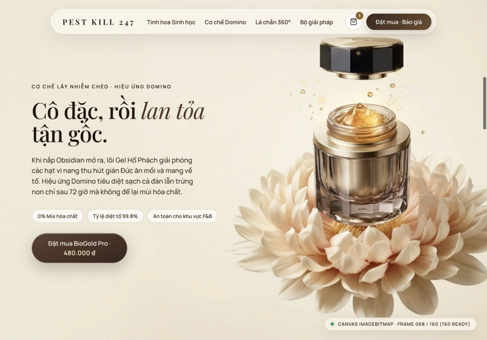

# Pest Kill 247 — Canvas `ImageBitmap` Scroll-Scrubbing Web Engine (`galatea-rife-pk247`)

> **Bản đóng gói bộ máy Web cuộn 3D siêu mượt theo kiến trúc Ascenta Studio (`PIVOINE`)**  
> Phát triển cho: **PEST KILL 247 — CÔNG TY TNHH TM DV KỸ THUẬT HOÀNG TRANG VIỆT NAM** (`pestkill247.com` · Hotline: `0902 972 860`)



---

## 1. Công nghệ cốt lõi trong Repo này (100% Pure HTML/CSS/JS + Python Binary Packager)

Thay vì dùng WebGL/Three.js thời gian thực (nặng GPU, kén máy di động) hoặc thẻ `<video>` (bị trễ keyframe khi cuộn ngược), bộ máy này sử dụng kiến trúc **Canvas 2D `ImageBitmap` Binary Frame Scrubbing**:

1. **HTML5 `<canvas id="film">` toàn màn hình (`2x Retina DPR`)**:
   - Cố định (`position: fixed; inset: 0; height: 100lvh`), vẽ trực tiếp các đối tượng `ImageBitmap` đã giải mã sẵn trên GPU với tốc độ `60–120 FPS`.
2. **Đóng gói Nhị phân phân tầng (`packs/frames/*.bin` + `framemap.js`)**:
   - `packs/frames/s_00.bin`: Gói khởi động nhẹ (lấy mẫu mỗi 4 frame) giúp người dùng cuộn mượt tức thì trong `< 150ms` ngay khi vừa vào trang.
   - `packs/frames/c_0000.bin` & `c_0001.bin`: Các gói frame `.webp` độ phân giải đầy đủ (`1280×720`) tải ngầm song song, tự động cắt byte theo offset (`ArrayBuffer.slice` → `Blob` → `createImageBitmap`).
   - `framemap.js` (`window.__FMAP`): Bảng ánh xạ 1.001 nấc cuộn (`LUT`) sang chỉ số frame.
3. **Cuộn mượt quán tính (`lenis.min.js`)**:
   - Nội suy chuyển động lăn chuột mượt mà (`lerp: 0.09`), đồng bộ hóa vị trí cuộn với `<canvas id="film">` và các thẻ nội dung ghim cố định bên trái (`#stage-deck`).
4. **Giỏ hàng & Báo giá B2B 3 bước ngay trên trang (`checkout.js` + `checkout.css`)**:
   - Mở Modal thanh toán & yêu cầu báo giá trực tiếp không cần tải lại trang, tích hợp thẻ ngân hàng 3D tương tác theo góc di chuột.

---

## 2. Cấu trúc thư mục

```text
├── index.html                  # Giao diện chính + Bộ giải mã Binary ImageBitmap + Đồng bộ cuộn
├── framemap.js                 # Bảng ánh xạ offset byte & LUT 1.001 điểm (sinh tự động bởi build_film.py)
├── lenis.min.js                # Thư viện Smooth Scroll tự host (Lenis v1.1.14)
├── checkout.js                 # Logic giỏ hàng, tính tổng đơn & Modal 3 bước B2B/B2C
├── checkout.css                # Giao diện Modal thanh toán & Thẻ ngân hàng 3D
├── tools/
│   └── build_film.py           # Script Python nội suy quang học (Optical Warp) & đóng gói .bin
├── packs/
│   └── frames/
│       ├── h.bin               # Header metadata nhị phân
│       ├── s_00.bin            # Startup pack (41 keyframes khởi động tức thì)
│       ├── c_0000.bin          # Chunk 0 (Frames 000..079)
│       └── c_0001.bin          # Chunk 1 (Frames 080..159)
└── assets/
    ├── demo_screenshot.png     # Ảnh chụp màn hình thực tế trang web
    ├── keyframes/              # 3 ảnh gốc Studio Keyframes đầu vào cho build_film.py
    ├── preview_frames/         # Các frame mẫu xuất ra để kiểm tra nhanh
    └── products/               # Hình ảnh 4 sản phẩm/dịch vụ trong khu vực Cửa hàng
```

---

## 3. Hướng dẫn chạy thử & Tái tạo bộ Frame mới

### Chạy máy chủ локал (Local Server)
```bash
python3 -m http.server 8788
# Mở trình duyệt tại: http://localhost:8788
```

### Đóng gói lại chuỗi 160 Frame từ bộ Keyframes mới
Chỉ cần thay 3 ảnh tại `assets/keyframes/` (`keyframe_1_bloom.jpg`, `keyframe_2_levitate.jpg`, `keyframe_3_topdown.jpg`) và chạy:
```bash
/opt/homebrew/bin/python3 tools/build_film.py
```
Script sẽ tự động cân bằng màu nền, tính toán biến dạng quang học (`NumPy Bilinear Warp`), nén `.webp` và xuất lại toàn bộ `packs/frames/*.bin` + `framemap.js` trong ~23 giây.

---

## 4. Định hướng Ý tưởng Chuyển động 3D (Phase 2) chuẩn ngành Kiểm Soát Dịch Hại (Pest Control)

Bộ máy kỹ thuật trong repo này giữ nguyên 100%, nhưng thay vì dùng hình tượng *"Hoa & Hũ pha lê"* (mang hơi hướng mỹ phẩm), ở **Phase 2 cho Pest Kill 247** có thể thay bằng 3 kịch bản hình ảnh đánh trúng tâm lý khách hàng B2B/B2C ngành Diệt Côn Trùng:

1. **Kịch bản 1 — "Tia X-Quang Xuyên Vách Bếp & Hiệu Ứng Domino Diệt Tổ Gián Đức"**:
   - **Act I (`Frame 001–050`)**: Gian bếp inox nhà hàng F&B hiện đại nhìn bên ngoài sạch bóng.
   - **Act II (`Frame 051–110`)**: Khi cuộn chuột, lớp vỏ tủ bếp/gầm máy pha cà phê chuyển sang chế độ **X-Ray trong suốt**, lộ ra ổ gián Đức ẩn sâu bên trong. Đầu kim ống tiêm **Gel Pest Kill 247** điểm 1 giọt mồi sinh học phát sáng màu vàng hổ phách → Gián ăn mồi và tha về tổ → Sóng năng lượng Domino lan truyền làm toàn bộ ổ gián bị tiêu diệt tận gốc.
   - **Act III (`Frame 111–160`)**: Vách bếp đóng lại sáng bóng cùng biểu tượng khiên bảo vệ **Chuẩn Kiểm Toán HACCP & An Toàn Thực Phẩm**.
2. **Kịch bản 2 — "Giải Phẫu 3D Trạm Kiểm Soát Chuột Thông Minh & 3 Vòng Đai Bảo Vệ Nhà Máy"**:
   - Khi cuộn chuột, hộp **Trạm Bẫy Chuột Pest Kill 247** tách lớp cơ khí 3D (Exploded View): Nắp khóa an toàn chống trẻ em/vật nuôi → Khay mồi sinh học chống ẩm → Cơ chế tác động làm chuột tự tìm ra nguồn sáng/nguồn nước bên ngoài (cam kết không chết hôi trong trần hay vách tường).
3. **Kịch bản 3 — "Đầu Phun ULV Hàn Quốc & Hạt Sương Nano 50 Micron Khóa Hạ Côn Trùng"**:
   - Góc máy Macro quay chậm đầu phun ULV tách lớp cơ khí, phóng ra luồng sương lạnh siêu mịn `< 50 micron` lơ lửng khóa chặt thần kinh muỗi/côn trùng bay mà không làm ướt hay ố bề mặt nội thất gỗ/đá tự nhiên.
